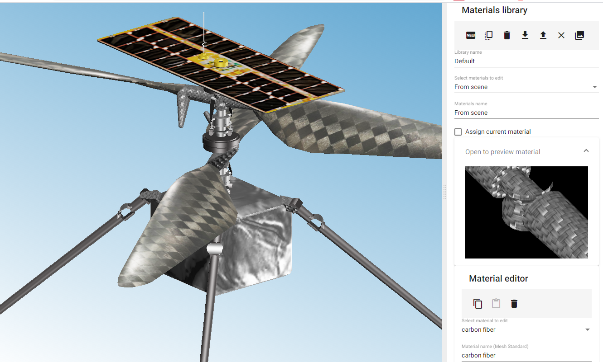

# SceneEditor

*ThreeJS scene editor.*  
ThreeJS has a [Scene Editor](https://threejs.org/editor/), but this editor is JavaScript based and difficult to extend. This project is to create Angular based alternative.

[Edit on StackBlitz ⚡️](https://stackblitz.com/github/VJigouline/SceneEditor)  
[Angular documentation](https://angular.io/docs)

This project was generated with [Angular CLI](https://github.com/angular/angular-cli) version 8.3.8.  
Project options: routing and [SCSS](https://sass-lang.com/documentation) as a style sheet.

## Version 1.0 released

Stable version 1.0 released. It covers significant part of editing for ThreeJS lights and materials. Viewing GLTF, Collada and STL files. Editing lights and materials for imported files. Retrieving materials from the loaded GLTF and Collada files. Saving and loading lights and materials to reuse in other projects. Exporting scene in GLTF format.

## Version 2.0

Version 2.0 moves the project from Angular 12 to Angular 22, TypeScript 6.0 and three.js r187.

Requirements: Node.js `^22.22.3 || ^24.15.0 || >=26.0.0` and npm 12. Install with `npm ci`, build with `npm run build`, run with `npm start`.

TypeScript stays on 6.0 because the Angular 22 compiler requires `>=6.0 <6.1`.

## Release builds
Release build can be found on master branch in the builds\Releases folder.
### Installation
Unzip release build archive into folder on the web server and call index.html file. Due to security limitations of the web browsers the build can be run only from the web server. Running build from the local computer will cause script loading failures.

## Further development
Implementation of constructive geometry creation and editing.

## Usage
See the [user guide](https://github.com/VJigouline/SceneEditor/wiki) in the wiki.

Working version at [scene.meercad.com](http://scene.meercad.com). This site runs an older build than Version 2.0.

This project is not finished. Drop GLTF/GLB (file or folder), Collada (file or folder), STL, IFC, STEP, IGES, Rhino, DXF, Blender, OBJ, FBX, 3DS, USD, USDZ, 3MF, PLY, SVG, CityJSON, G-code, VRML, X3D, AMF, OFF, KMZ, Draco, LAS/LAZ, E57, XYZ, PCD, Ogre (files, folder or zip), HDR and EXR environment maps or `.polygons` files into graphics area on the left, or choose files with **Open files** on the **Scene** tab, or open them from the internet (see [Opening models from the internet](#opening-models-from-the-internet)), and try using controls. Scenes saved as glTF, OBJ, STL, 3MF, PLY or USDZ can be loaded the same way; see [Saving scenes](#saving-scenes).

### Opening models from the internet

Choose **Open from a URL** (the link button on the **Scene** tab), paste the address of a model and press **Open**. Any format SceneEditor can open works, including a zip. The files a model references beside it are read too: the buffers and textures of a `.gltf` file, and the `.mtl` materials of an `.obj` file with their textures. A link to a file's page on GitHub is turned into a link to the file itself. CityJSON named plain `.json` is recognised by its contents.

To share a model, add its address to SceneEditor's: `https://vjigouline.github.io/SceneEditor/?url=https://example.com/model.glb` opens SceneEditor with that model loaded. A model address with its own `?` or `&` must be URL-encoded first.

The server must allow other sites to read its files (CORS). GitHub's raw files and most model hosting and storage services do; if a server doesn't, SceneEditor says so, and the file can be downloaded and dropped instead.

### IFC models

IFC files (`.ifc`) are read by [mc-ifc-import](https://github.com/VJigouline/mc-ifc-import): IFC2X3 and every schema of the IFC4 line (IFC2X4, IFC4 with its addenda, IFC4X1, IFC4X2 and IFC4X3), with the schema version detected from the file. Elements come with their colours, in their spatial structure, with their properties in `userData.ifc`.

### STEP models

STEP files (`.stp`, `.step`, `.p21`, and gzip-compressed `.stpz`) are read by [mc-step-import](https://github.com/VJigouline/mc-step-import). It reads AP203, AP214 and AP242, with the application protocol detected from the file.

- **Solids:** B-rep solids with planar, analytic and NURBS faces are tessellated into watertight meshes.
- **Structure:** parts come in their assembly structure, in metres, with the file's colours.
- **Data:** product data is in `userData.step`.

### DXF drawings

DXF drawings (`.dxf`), ASCII or binary, from R12 to the latest AutoCAD versions, are read by [mc-dxf-import](https://github.com/VJigouline/mc-dxf-import).

- **Contents:** lines, arcs, polylines, splines, 3D faces, meshes, solid fills and hatches, in their layers and AutoCAD colours, with blocks expanded where they are inserted. A flat drawing faces the front view; a 3D drawing is turned Y up.
- **Not drawn:** text, pattern hatches and ACIS solids.
- **Details:** see [Using it in SceneEditor](https://github.com/VJigouline/mc-dxf-import/blob/main/Documentation/SceneEditor.md).

### Blender models

Blender files (`.blend`) are read by [mc-blender-import](https://github.com/VJigouline/mc-blender-import), from Blender 2.5 to 5.x, compressed or not, without Blender itself. Images packed into the file need nothing else; for other images, drop the .blend file together with them, its folder, or a zip.

- **Contents:** the current scene's objects with their parenting and collection instances, lights and cameras. Principled BSDF and other node materials become standard materials, with their textures, that can be edited on the **Materials** tab.
- **Not read:** modifiers, armatures and animation, curves and text.
- **Details:** see [Using it in SceneEditor](https://github.com/VJigouline/mc-blender-import/blob/main/Documentation/SceneEditor.md).

### Ogre models

Ogre 3D resources are read by [mc-ogre-import](https://github.com/VJigouline/mc-ogre-import): dotScene `.scene` files, binary `.mesh` and XML `.mesh.xml` meshes, `.material` scripts and their textures. An Ogre model is several files, so drop its folder, drop or open its files together, or drop or open a zip of them.

- **Contents:** scenes come with their node structure, lights and cameras. Materials become standard materials that can be edited on the **Materials** tab.
- **Not read:** skeletons and animations; meshes are shown in their bind pose.
- **Details:** see [Using it in SceneEditor](https://github.com/VJigouline/mc-ogre-import/blob/main/Documentation/SceneEditor.md).

### Other formats

Each of these is read by its own package, which has a page on using it in SceneEditor:

| Files | Package | Notes |
| --- | --- | --- |
| IGES (`.igs`, `.iges`) | [mc-iges-import](https://github.com/VJigouline/mc-iges-import) | Trimmed NURBS and analytic surfaces and B-rep solids are tessellated, with colours, levels and units. |
| Rhino (`.3dm`) | [mc-3dm-import](https://github.com/VJigouline/mc-3dm-import) | Meshes, the render meshes of Breps and extrusions, SubDs, curves and blocks, by layer. Read with rhino3dm, whose WebAssembly is served from `assets/rhino3dm`. |
| Wavefront OBJ (`.obj`) | [mc-obj-import](https://github.com/VJigouline/mc-obj-import) | Drop it with its `.mtl` files and textures, its folder, or a zip. |
| FBX (`.fbx`) | [mc-fbx-import](https://github.com/VJigouline/mc-fbx-import) | Binary or ASCII, FBX 7.0 and later; drop external textures with it. |
| 3D Studio (`.3ds`) | [mc-3ds-import](https://github.com/VJigouline/mc-3ds-import) | Drop it with its textures, its folder, or a zip. |
| USD (`.usd`, `.usda`, `.usdc`) | [mc-usd-import](https://github.com/VJigouline/mc-usd-import) | Drop the root layer with the layers and textures it uses, or their folder: the shallowest layers are opened, and the deeper ones are taken as their references. |
| USDZ (`.usdz`) | [mc-usdz-import](https://github.com/VJigouline/mc-usdz-import) | |
| 3MF (`.3mf`) | [mc-3mf-import](https://github.com/VJigouline/mc-3mf-import) | With colours and textures, in the model's units. |
| PLY (`.ply`) | [mc-ply-import](https://github.com/VJigouline/mc-ply-import) | Files without faces are shown as point clouds. |
| SVG (`.svg`) | [mc-svg-import](https://github.com/VJigouline/mc-svg-import) | Flat fills and strokes, facing the front view. |
| CityJSON (`.city.json`, `.jsonl`) | [mc-cityjson-import](https://github.com/VJigouline/mc-cityjson-import) | A CityJSON file named plain `.json` must be renamed `.city.json`, as other JSON files are not models. |
| G-code (`.gcode`, `.gco`, `.nc`, `.ngc`, `.tap`, `.cnc`) | [mc-gcode-import](https://github.com/VJigouline/mc-gcode-import) | CNC toolpaths by tool, with rapids, arcs and drilling cycles; 3D-printer programs by layer. |
| VRML (`.wrl`, `.wrz`) | [mc-vrml-import](https://github.com/VJigouline/mc-vrml-import) | VRML 2.0, with its textures. |
| X3D (`.x3d`, `.x3dv`, `.x3dz`, `.x3dvz`) | [mc-x3d-import](https://github.com/VJigouline/mc-x3d-import) | XML and classic encodings, with their textures. |
| AMF (`.amf`) | [mc-amf-import](https://github.com/VJigouline/mc-amf-import) | Plain or zipped, in the file's units. |
| OFF (`.off`) | [mc-off-import](https://github.com/VJigouline/mc-off-import) | With face and vertex colours. |
| KMZ (`.kmz`) | [mc-kmz-import](https://github.com/VJigouline/mc-kmz-import) | Google Earth archives: Collada models placed as the KML says. |
| Draco (`.drc`) | [mc-draco-import](https://github.com/VJigouline/mc-draco-import) | Decoded with three.js's Draco decoder, served from `assets/draco3d`. |
| LAS and LAZ (`.las`, `.laz`) | [mc-las-import](https://github.com/VJigouline/mc-las-import) | LiDAR point clouds, coloured by colour, intensity or height. LAZ is decompressed with laz-perf, whose WebAssembly is served from `assets/laz-perf`. |
| E57 (`.e57`) | [mc-e57-import](https://github.com/VJigouline/mc-e57-import) | 3D scans, each scan placed by its pose. |
| XYZ (`.xyz`, `.pts`) | [mc-xyz-import](https://github.com/VJigouline/mc-xyz-import) | Text point clouds, with colours and intensity. |
| PCD (`.pcd`) | [mc-pcd-import](https://github.com/VJigouline/mc-pcd-import) | Point Cloud Library files, ASCII, binary or compressed. |

A zip holding an OBJ, FBX, 3DS, USD, VRML or X3D model is opened with its importer, like a zip holding a `.blend` file; other zips are opened as Ogre resources.

### Environment maps

Radiance HDR (`.hdr`) and OpenEXR (`.exr`) images are read by [mc-hdr-import](https://github.com/VJigouline/mc-hdr-import) and [mc-exr-import](https://github.com/VJigouline/mc-exr-import). Dropping or opening one makes it the scene's environment: it lights the materials with image-based lighting and shows as the background. Point clouds are moved near the origin, as scan coordinates are too large for the GPU's precision.

### Saving scenes

**Save Scene** on the **Scene** tab writes the visible scene, without the transform gizmo and light helpers, in the format chosen under **Select output format**:

| Format | Package | Notes |
| --- | --- | --- |
| glTF binary (`.glb`), the default | [mc-gltf-export](https://github.com/VJigouline/mc-gltf-export) | One compact file, with materials, textures, lights and cameras, that SceneEditor and most 3D programs open. |
| glTF text (`.gltf`) | [mc-gltf-export](https://github.com/VJigouline/mc-gltf-export) | Readable JSON with the data inline. |
| glTF with Draco compression (`.glb`) | [mc-gltf-export](https://github.com/VJigouline/mc-gltf-export) | Meshes several times smaller. Viewers need a Draco decoder, as SceneEditor has. |
| Wavefront OBJ with materials (`.zip`) | [mc-obj-export](https://github.com/VJigouline/mc-obj-export) | The .obj, its .mtl and PNG textures. |
| STL (`.stl`) | [mc-stl-export](https://github.com/VJigouline/mc-stl-export) | Triangles for 3D printing, in millimetres and Z up. |
| 3MF (`.3mf`) | [mc-3mf-export](https://github.com/VJigouline/mc-3mf-export) | 3D printing with colours, in millimetres and Z up. |
| PLY (`.ply`) | [mc-ply-export](https://github.com/VJigouline/mc-ply-export) | Meshes and point clouds with their colours. |
| USDZ (`.usdz`) | [mc-usdz-export](https://github.com/VJigouline/mc-usdz-export) | For AR Quick Look on iPhone and iPad. |
| Three scene (`.json`) | three.js | three.js's own scene format, which SceneEditor can't open again. |

### Photorealistic tab

The **Photorealistic** tab ray traces the scene, with shadows and reflections, progressively and in Web Workers, using [mc-raytracer](https://github.com/VJigouline/mc-raytracer). The ray traced image can replace the main 3D view or appear in a separate browser window that follows the main view's camera. Press **Z** to switch between the three.js view and the ray traced view, as in Blender. The tab sets samples, bounces, resolution, preview, worker threads, shadows, global illumination, tone mapping, exposure, colour space and background, and saves the image as a PNG. See [Ray tracing](https://github.com/VJigouline/SceneEditor/wiki/Ray-Tracing) in the wiki.

_The image is made from the GLTF model loaded into **SceneEditor**. The model can be found on [NASA Ingenuity page](https://mars.nasa.gov/resources/25043/mars-ingenuity-helicopter-3d-model/?site=insight). After loading model will look dark due to darker materials. Lights intensity should be increased in the **Light Editor**_

## Additional modules

These modules should be added on top of the standard angular installation (`npm install` should do it for you)

### Dependencies

`npm install angular-split` [Documentation](https://bertrandg.github.io/angular-split/#/documentation)  
`npm install three` [Documentation](https://threejs.org/docs/#manual/en/introduction/Import-via-modules)  
`ng add @angular/material` [Documentation](https://material.angular.io/guide/getting-started).  
`npm install file-saver` [Documentation](https://www.npmjs.com/package/file-saver)  
`npm install ngx-color-picker` [Documentation](https://www.npmjs.com/package/ngx-color-picker)  
`npm install angular-in-memory-web-api` [Documentation](https://angular.io/tutorial/toh-pt6) - web server simulation for the testing  
`npm install uuid` [Documentation](https://www.npmjs.com/package/uuid)  
`npm install ngx-file-drop` [Documentation](https://www.npmjs.com/package/ngx-file-drop)  
`npm install --save-dev @types/three` [Documentation](https://github.com/DefinitelyTyped/DefinitelyTyped)  
`npm install ngx-spinner --save` [Documentation](https://www.npmjs.com/package/ngx-spinner) - loading spinner.

## Development server

Run `ng serve` for a dev server. Navigate to `http://localhost:4200/`. The app will automatically reload if you change any of the source files.

## Code scaffolding

Run `ng generate component component-name` to generate a new component. You can also use `ng generate directive|pipe|service|class|guard|interface|enum|module`.

## Build

Run `ng build` to build the project. The build artifacts will be stored in the `dist/` directory. The build is a production build by default.

## Running unit tests

Run `ng test` to execute the unit tests via [Karma](https://karma-runner.github.io). This currently stops with compile errors, because several older spec files call constructors with the wrong arguments.

## Further help

To get more help on the Angular CLI use `ng help` or go check out the [Angular CLI README](https://github.com/angular/angular-cli/blob/master/README.md).
